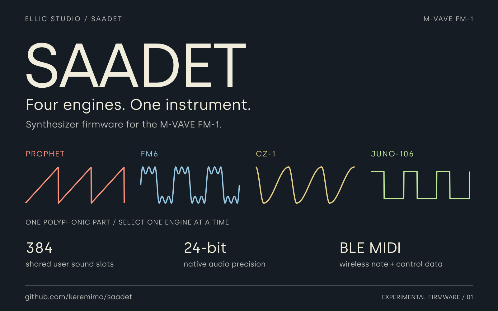
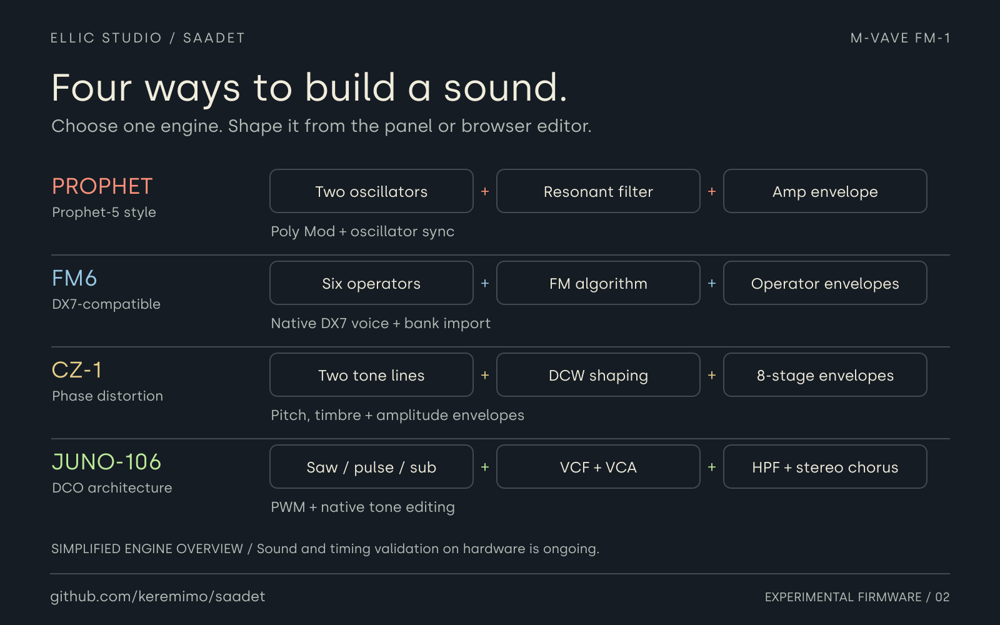
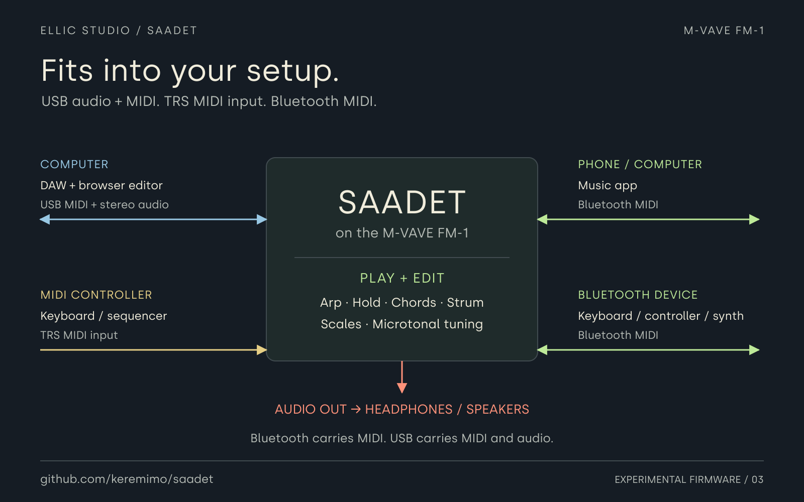
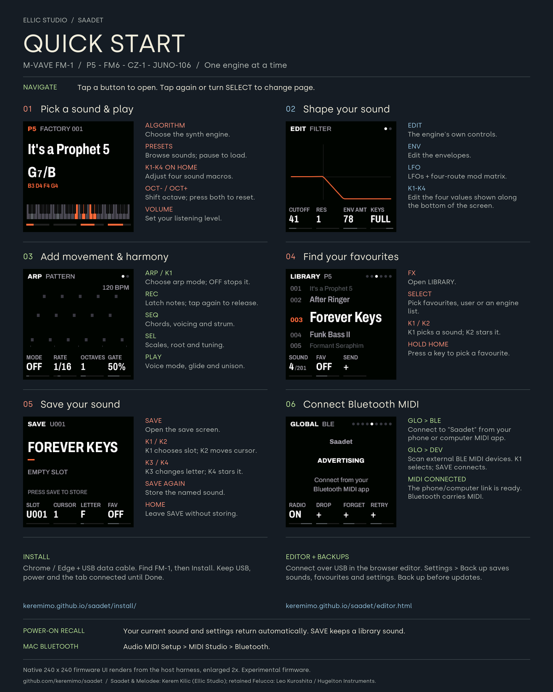

# Saadet

A single-part synthesizer fork of Melodee for the **M-VAVE FM-1**, with Bluetooth MIDI.

[Install Saadet](https://keremimo.github.io/saadet/install/) ·
[Web editor](https://keremimo.github.io/saadet/editor.html) ·
[Quick start](QUICKSTART.md) ·
[Releases](https://github.com/keremimo/saadet/releases)

> **Experimental firmware.** Final audio, control, timing and Bluetooth acceptance
> of the exact release package remains pending. Back up sounds and settings before
> switching firmware; read the [release notes](RELEASE_NOTES.md) for current limits.

## Play and shape sounds

Choose **Prophet, FM6, CZ-1 or JUNO-106**, one engine at a time. Edit sounds on the
panel or in the browser, with factory libraries and native SysEx import/export.

- **Perform:** arpeggiator, HOLD, chords, strum, scales and microtonal tuning.
- **Keep your sounds:** favourites, 384 shared user slots and automatic last-sound recall.
- **Connect:** USB MIDI, TRS MIDI input and Bluetooth MIDI; stereo USB playback
  and synth-master capture at 44.1 kHz, with 16/24-bit USB formats.

  
  

Open either graphic for a closer look. The common audio path renders at native
24-bit precision, independently of the selected USB format. Saadet is a dedicated
single-part synth; sequencing, multitrack recording and shared insert effects are
outside its scope.

## Quick-start cheat sheet

The main controls beside six native firmware UI captures, rendered by the host
harness. Open the image for the full-resolution PNG, or use the
[written quick start](QUICKSTART.md) and [complete panel guide](docs/UI.md).

  

## Storage and compatibility

**Installing and saving Saadet over Melodee can replace Melodee project A data.**
Keep a backup before switching firmware families. Melodee project and backup files
cannot be restored as Saadet backups. The editor's Settings page provides complete
Saadet backups of sounds, favourites and settings.

Flash layouts, backup formats and legacy sound compatibility are covered in the
[technical overview](docs/TECHNICAL_OVERVIEW.md#storage-and-compatibility).

## Documentation

- [Panel guide](docs/UI.md): editing, performance controls, Bluetooth and SysEx.
- [Build, test and recovery](BUILDING.md): firmware targets, installer and optional m-bootloader.
- [Release notes](RELEASE_NOTES.md): included features and outstanding hardware checks.
- [Technical overview](docs/TECHNICAL_OVERVIEW.md): architecture, compatibility and project history.

## Validation and provenance

Automated checks cover engines, MIDI, storage, UI, native 24-bit transport and
firmware packaging. Physical audio quality and sustained timing still need
hardware validation; see the [validation record](docs/VALIDATION.md) and
[BLE migration record](docs/BLE_MIGRATION.md).

New Saadet/Melodee work is by **Kerem Kilic (Ellic Studio)**. Retained Felucca work
is by **Leo Kuroshita (@kurogedelic), Hügelton Instruments**, with its notices kept.
FM6 uses the MSFA renderer; factory sound data retains its vendor attribution.
See [LICENSING.md](LICENSING.md), [LICENSE](LICENSE) and [LICENSES](LICENSES/)
for the applicable file-by-file terms and third-party notices.

## Support
[Buy me a coffee](https://ko-fi.com/keremimo)
